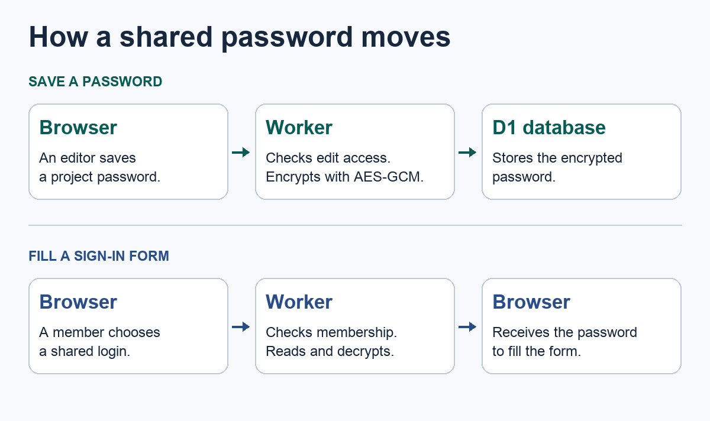

# Global Login

When a teammate asks for the staging password, point them to the project in Global Login. Your team can find the right account on the web and fill it from Chrome or Brave. Each member also has a private vault for their own items.

[Open the dashboard](https://globallogin.peacockindia.in) · [Install the Chrome extension](https://chromewebstore.google.com/detail/global-login/imfpfomcpgonkjjlaaeginadicnanoeb) · [Self-host a workspace](SELF_HOSTING.md)

## Your first sign-in

1. **Join your workspace.** Open the dashboard and sign in with Google. A workspace administrator approves new members.
2. **Connect your browser.** Install the extension from the store link above, open it, and choose **Continue with Google**. For a self-hosted workspace, first set the backend URL in extension **Settings**. Your administrator must allowlist the extension ID.
3. **Use a project account.** Open a saved project site, click its sign-in field, and choose the account you need. You can also start in the extension and choose **Open & Fill**.


[Browse the screenshots](https://devlogin.peacockindia.in/store/index.html)

## What you can do

### Work with project logins

- **Find the right account.** Keep local, staging, and production logins under one project. Tag projects and logins, sort them, organize accounts into collections, or group related projects together. Refresh website icons individually or in bulk.
- **Sign in from the browser.** Pick a matching login in a form, use the floating chooser, or search other accounts with the keyboard. Review suggested saves and password changes. You can turn off the floating prompt or exclude individual sites.
- **Set up a new account.** Generate a password in the extension or on a signup form, fill identity fields from a saved profile, or open the external temporary-mailbox shortcut.

### Keep your own items private

- **Personal vault.** Store items in 21 categories, including identities, cards, passwords, API credentials, SSH keys, documents, and secure notes. Open **My private vault** from the dashboard or extension.
- **File attachments.** Upload files up to 50 MiB each, then download, rename, or delete them. A document can reference an uploaded file. Even when you attach a file to a shared login, only you can access the file through the workspace.

### Manage the workspace

- **Membership and permissions.** Administrators approve members and manage editing and backup permissions. Approved members with view-only access can use shared passwords. Editing requires additional permission.
- **Login activity.** See who changed a login and when, including changes made through a connected AI client.
- **AI tools via MCP.** Connect an AI client with a personal token to manage logins, organize collections, refresh icons, or work with personal items and files. Actions use the member’s permissions.
- **Backup and restore.** Export shared projects and accounts, or import them into a workspace. Exports include readable passwords. Import requires both backup and edit access.
- **Self-hosting.** Run your own deployment on Cloudflare and connect the extension to it. [Deployment and upgrade guide](SELF_HOSTING.md)

## How Global Login protects a saved password



**When you save**, the Worker checks that you can edit shared logins. It encrypts the password using AES-256-GCM with a fresh random nonce and binds it to the account ID. A copy of the D1 database alone cannot reveal the password. If someone changes the encrypted value or moves it to a different account, decryption fails.

**When you fill**, the Worker checks your session and workspace approval before returning the requested password. The server holds the decryption key, and your browser receives the readable password to fill the form. This means you trust the workspace operator, approved teammates using shared logins, and the device doing the filling.

**For personal items**, the API checks the owner and binds encrypted fields to both owner and item IDs. File downloads also require an owner check. Attachments live separately in R2. The diagram describes the encryption of saved passwords.

[Encryption code](apps/worker/src/crypto.ts) · [Access checks](apps/worker/src/auth.ts) · [Private vault](apps/worker/src/personal-items.ts) · [File access](apps/worker/src/files.ts)

## Build or run it yourself

The dashboard uses React, TypeScript, and Vite. The browser extension uses React and WXT. A Hono API runs on Cloudflare Workers, with Drizzle ORM and D1 for records and R2 for files.

<details>
<summary>Run the project locally</summary>

Use Bun 1.3.14+ and Node.js 20.19+. On a fresh checkout, install dependencies and initialize the local credential key.

```sh
bun install --frozen-lockfile
bun run secrets:init
```

Set `GOOGLE_CLIENT_ID` and `GOOGLE_CLIENT_SECRET` in the generated `apps/worker/.dev.vars`. Register `http://localhost:8787/api/auth/callback` as a redirect URI for your Google web OAuth client.

```sh
bun run db:local
bun run build:web
bun run dev
```

Open the dashboard at `http://localhost:5173`. To develop the extension, run `bun run dev:extension` in another terminal, set its backend to `http://localhost:8787`, and add its browser ID to `EXTENSION_IDS` in the local Worker environment.

### Approve the first local administrator

Sign in once so the database has your user record. Replace the example email with the address you used, then click **Check approval** in the dashboard.

```sh
cd apps/worker
bunx wrangler d1 execute devlogin --local --command "UPDATE users SET approved = 1, is_admin = 1 WHERE email = 'you@example.com'"
```

For a new self-hosted deployment, use your database name and `--remote` from its configured Worker directory. After bootstrap, manage workspace access from **Users**.

</details>

## Downloads and support

Follow the [self-hosting guide](SELF_HOSTING.md) to configure Cloudflare Workers, D1, R2, and Google sign-in. When upgrading, keep the existing database, bucket, and credential encryption key so members retain access to their saved data.

For a manual extension install, download and extract the Chrome ZIP, enable **Developer mode** on the browser extensions page, choose **Load unpacked**, and select the folder containing `manifest.json`.

[Changelog](CHANGELOG.md) · [Release downloads](https://github.com/jacksonkasi1/devlogin/releases) · [Chrome Web Store screenshot files](apps/web/public/store)
