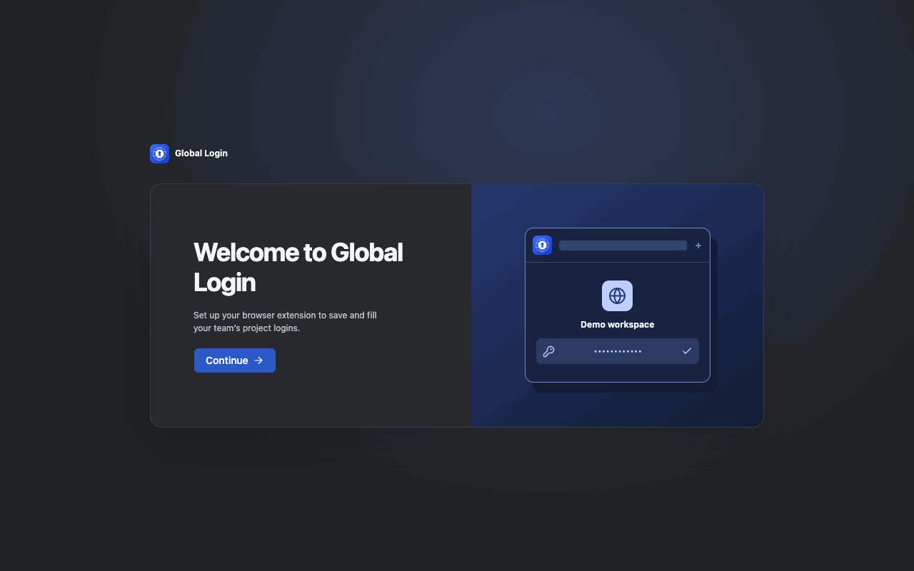

# Global Login

Global Login gives your team a shared place for project logins and each member a private vault. Organize accounts on the web, then use the Chrome or Brave extension to fill the right login on a project site.

[Open the dashboard](https://globallogin.peacockindia.in) · [Download the extension](https://github.com/jacksonkasi1/devlogin/releases/latest) · [Self-hosting and upgrades](SELF_HOSTING.md)



[View the individual screenshots](https://devlogin.peacockindia.in/store/index.html)

## Features

- 🗂️ **Projects and collections.** Keep local, staging, and production logins together. Group projects by tag, or create a collection inside one project.
- 🔑 **Browser autofill.** Choose a matching account from a sign-in field or use **Open & Fill** in the popup. Review suggested saves and password updates before adding them to the workspace.
- 🔒 **Private vault.** Store your own identities, cards, API credentials, and secure notes. Personal items are visible only to their owner.
- 📎 **File attachments.** Upload files up to 50 MiB each. A file you attach to a shared login stays private to you.
- 🎲 **Password generator.** Generate a password from the extension’s Tools menu or while filling a signup form.
- 🤖 **MCP and activity.** Ask your AI client to organize collections or refresh favicons. A login’s activity shows who changed it, including edits made through MCP.

## Get started

1. **Sign in.** Open the dashboard with Google. A workspace administrator approves new members.
2. **Install the extension.** Download the Chrome ZIP from the latest release and extract it. In Chrome or Brave, open the extensions page, enable **Developer mode**, and choose **Load unpacked**. Select the extracted folder containing `manifest.json`.
3. **Connect your workspace.** Open Global Login and choose **Continue with Google**. For a self-hosted workspace, set the backend URL in extension **Settings** first. Its administrator must allowlist the extension ID shown by your browser.
4. **Use a login.** Open a saved project site, focus its login field, and choose an account. Use **My private vault** for items you want to keep personal.

## Run locally

Use Bun 1.3.14+ and Node.js 20.19+. On a fresh checkout, install dependencies and initialize the local credential key.

```sh
bun install --frozen-lockfile
bun run secrets:init
```

Set `GOOGLE_CLIENT_ID` and `GOOGLE_CLIENT_SECRET` in the generated `apps/worker/.dev.vars`. Register `http://localhost:8787/api/auth/callback` as a redirect URI for your Google web OAuth client.

```sh
bun run db:local
bun run build:web
bun run dev
```

Open the dashboard at `http://localhost:5173`. To develop the extension, run `bun run dev:extension` in another terminal, set its backend to `http://localhost:8787`, and add its browser ID to `EXTENSION_IDS` in the local Worker environment.

<details>
<summary>Approve the first local administrator</summary>

Sign in once so the database has your user record. Replace the example email with the address you used, then click **Check approval** in the dashboard.

```sh
cd apps/worker
bunx wrangler d1 execute devlogin --local --command "UPDATE users SET approved = 1, is_admin = 1 WHERE email = 'you@example.com'"
```

For a new self-hosted deployment, use your database name and `--remote` from its configured Worker directory. After bootstrap, manage workspace access from **Users**.

</details>

## Self-hosting and releases

Follow the [self-hosting guide](SELF_HOSTING.md) to configure Cloudflare Workers, D1, R2, and Google sign-in. When upgrading, keep the existing database, bucket, and credential encryption key so members retain access to their saved data.

[Changelog](CHANGELOG.md) · [Release downloads](https://github.com/jacksonkasi1/devlogin/releases) · [Chrome Web Store screenshot files](apps/web/public/store)
